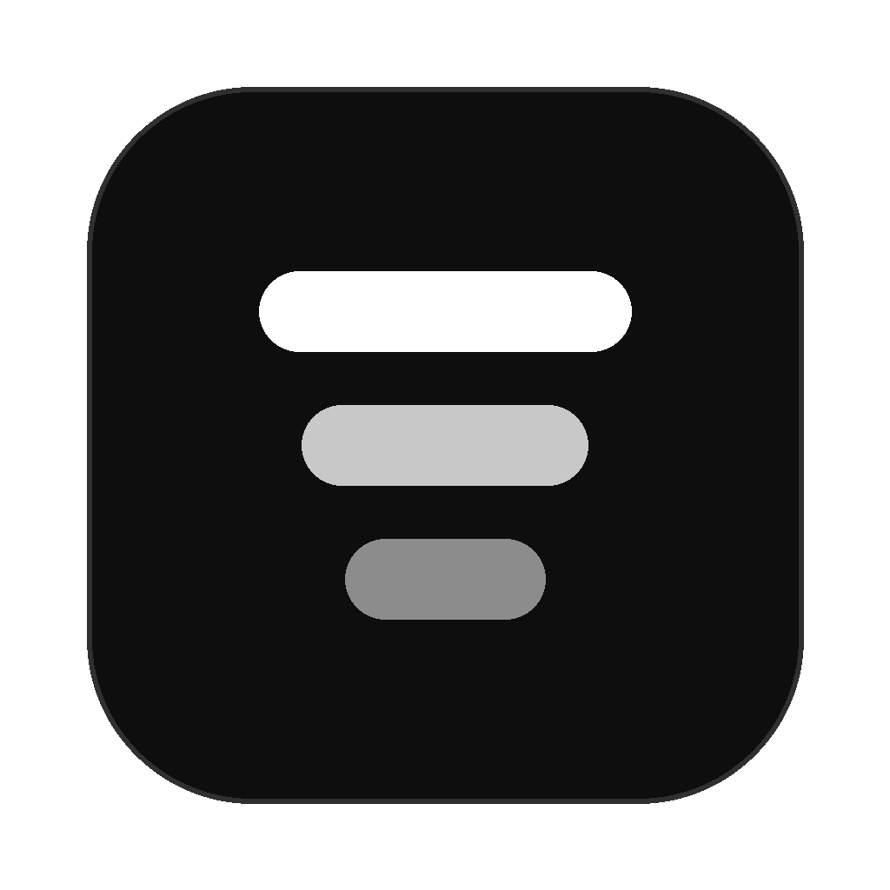
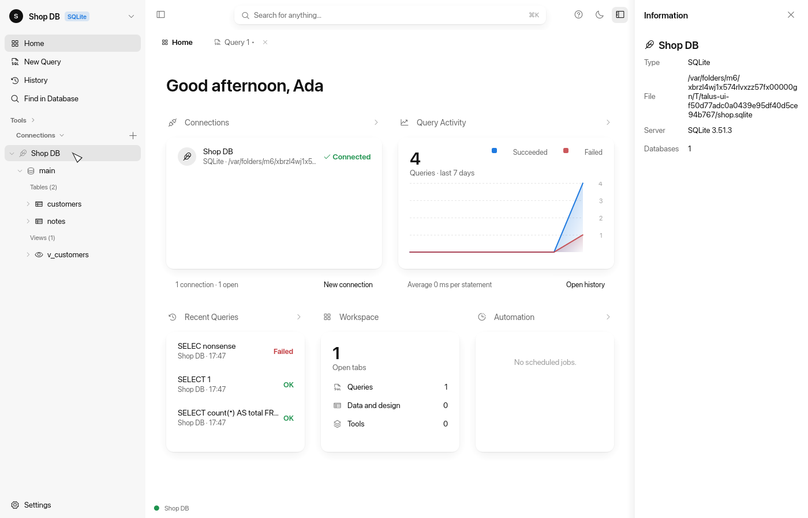
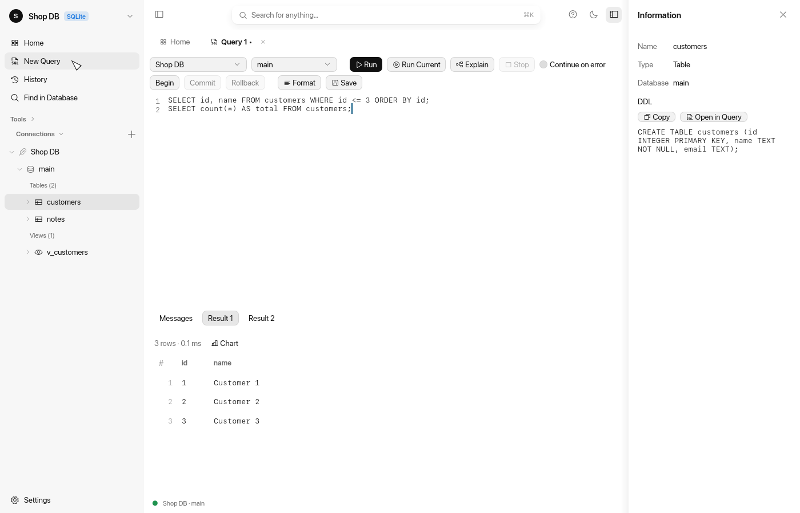
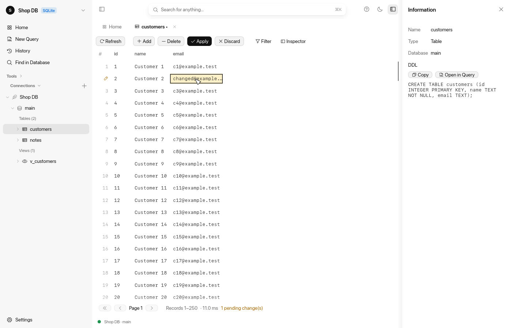
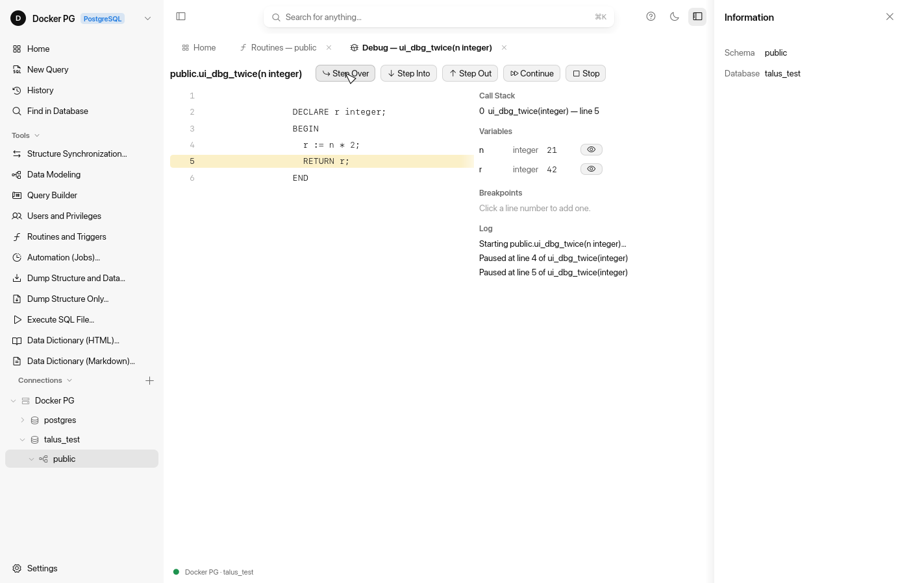
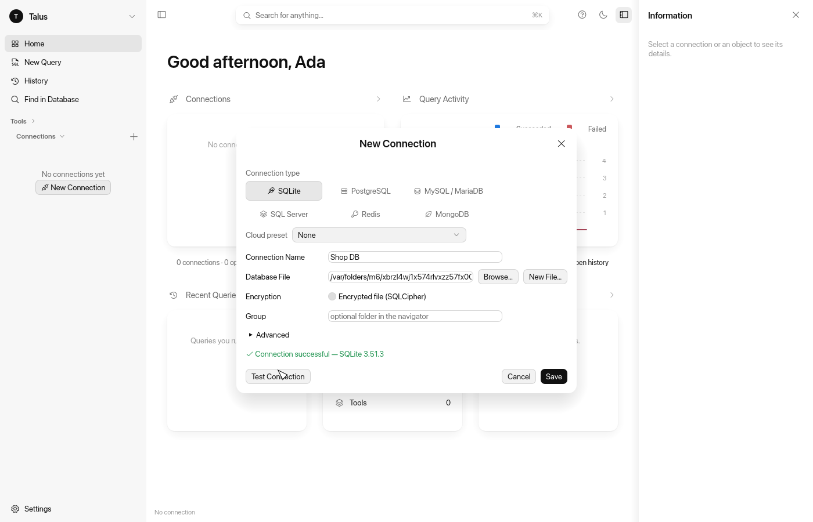

<div align="center">



# Talus

**A fast, native database client for macOS, written entirely in Rust.**

One window for SQLite, PostgreSQL, MySQL / MariaDB, SQL Server, Oracle, Snowflake, Redis and MongoDB:
a quiet, monochrome interface, with no trial, no licence keys and no edition gating.

[](Cargo.toml)
[](https://www.rust-lang.org)
[](#getting-started)
[](LICENSE)
[](https://github.com/emilk/egui)

[Getting started](#getting-started) ·
[Features](#features) ·
[Screenshots](#screenshots) ·
[Architecture](#architecture) ·
[Testing](#testing) ·
[Roadmap](#roadmap) ·
[Support](#support)

<br>



</div>

<br>

## Why Talus

- **Native and light.** Pure Rust with an immediate-mode UI rendered through Metal. The first frame appears in
  ~370 ms, the app idles at 0 % CPU, and the bundle is a single 30 MB `.app`.
- **Large data stays fast.** Grids are virtualised and exports stream. On a 1 M-row table a page at offset 900 k
  loads in 13 ms, and a full CSV export takes 1.9 s.
- **Safe by default.** Passwords live only in the macOS Keychain. Edits are applied in one transaction, and each
  must touch exactly one row. Destructive DDL asks first. SSH host keys are pinned.
- **Everything included.** Modelling, sync, debugging, automation and import/export are all in the one app. There are
  no editions and nothing to unlock.
- **Calm interface.** White surfaces, black text, one sidebar and a ⌘K search field. Colour is used only for state.

## Features

| Area | What you get |
|---|---|
| **Connections** | Keychain-backed secrets, groups, cloud presets, TLS modes (incl. `verify-full` with a CA file), **SSH tunnel** (password or key, pinned host keys), **HTTP tunnel** (proxy `CONNECT`, Basic auth) and **PHP tunnel** script ([`tunnel/talus-tunnel.php`](tunnel/talus-tunnel.php)) for shared hosting, session restore |
| **SQL editor** | Highlighting, context-aware completion (tables, aliases, columns), formatter, ⌘/ comments, run selection / current statement / script, cancel, multiple result sets with charts, `EXPLAIN`, manual transactions, history |
| **Data editor** | Paging, sort, filters, inline edit, cell inspector, NULL handling, insert / delete, transactional apply with rollback, copy as `INSERT` |
| **Schema** | Table designer (columns, indexes, foreign keys) with a diffed SQL preview, create / drop database, routines and triggers browser, users and privileges |
| **Modelling** | **Conceptual / logical / physical** models with lossless conversion, star schema and Data Vault templates, reverse engineering from a live schema, forward DDL for six engines, comparison with a database, ER diagram with SVG export, page-setup printing with preview and PDF for models and ER diagrams |
| **Debugging** | **PL/pgSQL debugger** and **PL/SQL debugger** (`DBMS_DEBUG`): breakpoints, Step Over / Into / Out, Continue, call stack, variables with Set Value, watch list, input parameters |
| **Transfer** | Import CSV / JSON / XML; streaming export to CSV, TSV, JSON, SQL, HTML, XML and Excel; SQL dump; execute an SQL file |
| **Sync & tools** | Structure and data synchronization, find in database, visual query builder, column profiling, test-data generator, data dictionary (HTML / Markdown), server monitor (cancel / kill sessions) |
| **Automation** | Scheduled jobs (backups, exports, SQL) run by `launchd`, with run history |
| **NoSQL** | Redis key browser and console; MongoDB document browser, editor and console |

<details>
<summary><b>Engine support matrix</b></summary>

<br>

| | SQLite | PostgreSQL | MySQL / MariaDB | SQL Server | Oracle | Snowflake | Redis | MongoDB |
|---|:---:|:---:|:---:|:---:|:---:|:---:|:---:|:---:|
| Browse, query, edit data | ✓ | ✓ | ✓ | ✓ | ✓ | ✓ | keys | documents |
| Table designer, indexes, FKs | ✓ | ✓ | ✓ | ✓ | ✓ | ✓ | — | — |
| Structure / data sync, dump | ✓ | ✓ | ✓ | ✓ | ✓ | ✓ | — | — |
| Users and privileges | — | ✓ | ✓ | ✓ | ✓ | users | — | — |
| Server monitor | — | ✓ | ✓ | ✓ | ✓ | cancel queries | — | — |
| Routines debugger | — | ✓ | — | — | ✓ | — | — | — |
| SSH / HTTP / PHP tunnel | — | ✓ | ✓ | ✓ | ✓ | — | ✓ | ✓ |
| Encryption at rest | SQLCipher | — | — | — | — | — | — | — |

</details>

## Screenshots

<table>
  <tr>
    <td width="50%"><p align="center"><sub><b>SQL editor</b>: multiple result sets, completion, history</sub></p></td>
    <td width="50%"><p align="center"><sub><b>Data editor</b>: pending changes apply in one transaction</sub></p></td>
  </tr>
  <tr>
    <td width="50%"><p align="center"><sub><b>PL/pgSQL debugger</b>: breakpoints, stack, variables</sub></p></td>
    <td width="50%"><p align="center"><sub><b>Connections</b>: Keychain secrets, TLS, SSH and HTTP tunnels</sub></p></td>
  </tr>
</table>

<sub>All screenshots are rendered headlessly by the UI test suite (see <a href="#testing">Testing</a>).</sub>

## Getting started

**Requirements:** macOS 12 or later, and Rust 1.90 or later (edition 2024). Xcode is not needed.

```sh
git clone https://github.com/fallowlone/Talus.git && cd Talus
cargo run -p talus-app --release        # run from source
scripts/bundle-macos.sh                  # → release/Talus.app, release/Talus-<version>-macos.zip (ad-hoc signed), release/talus-server
```

Press **⌘N** to add a connection, **⌘Y** to open a query, and **⌘K** to search.

<details>
<summary><b>Where your data lives</b></summary>

<br>

| What | Where |
|---|---|
| Connections, settings, session, history, jobs | `~/Library/Application Support/io.github.fallowlone.Talus/` (files are mode `0600`) |
| Passwords, key passphrases, proxy passwords | macOS Keychain, service `io.github.fallowlone.Talus`, only when "Save in Keychain" is checked |
| SSH host keys | `known_hosts` next to the files above; Talus keeps its own file |

</details>

<details>
<summary><b>Debugging PL/pgSQL routines</b></summary>

<br>

The server needs the [pldebugger](https://github.com/EnterpriseDB/pldebugger) extension:

```sql
-- postgresql.conf: shared_preload_libraries = 'plugin_debugger'   (then restart)
CREATE EXTENSION pldbgapi;
```

Then select a schema, open **Tools → Routines and Triggers**, pick a function and press **Debug**.

</details>

<details>
<summary><b>Keyboard shortcuts</b></summary>

<br>

| Keys | Action |
|---|---|
| ⌘K | Search (filters the Connections tree) |
| ⌘N / ⌘Y | New connection / new query |
| ⌘O / ⌘S / ⇧⌘S | Open / save / save as `.sql` |
| ⌘R | Run selection or script (query tab); refresh (data and objects tabs) |
| ⇧⌘R | Run the current statement |
| ⌥⌘E / ⌥⌘L | Explain / format SQL |
| ⌘/ | Toggle line comment |
| ⌃Space | Code completion |
| ⌘. | Stop the running query or page load |
| ⇧⌘F / ⇧⌘H | Find in database / history log |
| ⌘W | Close tab |
| ⇧⌘] / ⇧⌘[ , ⌃Tab | Next / previous tab |
| ⌘1 / ⌘2 | Toggle sidebar / information pane |
| ⌘↩ / ⌘⎋ | Apply / discard grid changes |
| ⌘+ / ⌘− | Add / delete record |
| ⌃0 | Set cell to NULL |
| F9 / F10 / F11 / ⇧F11 | Debugger: start or continue / step over / step into / step out |
| ⌘, | Settings |

</details>

## Architecture

```
┌──────────────────────────── talus-app (egui) ────────────────────────────┐
│  sidebar · top bar · tabs · dialogs          app/chrome.rs, app/home.rs   │
│  query, data, designer, model, debugger …    ui/*_tab.rs                  │
│  theme tokens (ink-alpha neutrals, SF Pro)   theme.rs, ui/widgets.rs      │
│                    │ Request / Response (never blocks a frame)            │
│                    ▼                                                      │
│  worker: tokio runtime, one session per tab, shared tunnels    worker.rs  │
└────────────────────┬──────────────────────────────────────────────────────┘
                     ▼
┌──────────────────────────── talus-core (no GUI) ─────────────────────────┐
│  engines: SQLite · PostgreSQL · MySQL · SQL Server · Redis · MongoDB      │
│  SQL lexer / splitter / dialects / DML builders · DDL diff · sync         │
│  export · import · dump · model_design · debugger · jobs · tunnel / ssh   │
│  stores: config · history · Keychain secrets                              │
└───────────────────────────────────────────────────────────────────────────┘
```

| Path | Purpose |
|---|---|
| [`crates/talus-core`](crates/talus-core) | Engines, SQL tooling, modelling, debugger, tunnels, stores. Fully testable headless. |
| [`crates/talus-app`](crates/talus-app) | The egui application (`talus` binary) and its worker. |
| [`docs/`](docs) | [Feature matrix](docs/feature-matrix.md), [architecture](docs/architecture.md), [progress](docs/progress.md), testing strategy. |
| [`docker-compose.test.yml`](docker-compose.test.yml), [`docker/`](docker) | Disposable PostgreSQL 17 (with pldebugger), MySQL 8.4, SQL Server 2022, Redis 7, MongoDB 7 and sshd. |
| [`assets/`](assets), [`scripts/`](scripts) | App icon and the bundling, icon and test-environment scripts. |

Main dependencies: [egui / eframe](https://github.com/emilk/egui), [tokio](https://tokio.rs),
[rusqlite](https://github.com/rusqlite/rusqlite), [tokio-postgres](https://github.com/sfackler/rust-postgres),
[mysql_async](https://github.com/blackbeam/mysql_async), [tiberius](https://github.com/prisma/tiberius),
[redis-rs](https://github.com/redis-rs/redis-rs), [mongodb](https://github.com/mongodb/mongo-rust-driver) and
[russh](https://github.com/Eugeny/russh).

## Testing

The suite uses real engines everywhere. The only mock in the tree is an in-memory secret store that stands in for
the Keychain. UI tests drive the actual app headlessly through AccessKit ([egui_kittest](https://github.com/emilk/egui/tree/master/crates/egui_kittest)).

```sh
cargo fmt --all --check
cargo clippy --workspace --all-targets -- -D warnings
cargo test --workspace                                    # SQLite integration + headless UI tests

eval "$(scripts/test-env.sh)" && cargo test --workspace   # + PostgreSQL, MySQL, Redis, MongoDB, SSH (Docker)

cargo test --release -p talus-core --test perf -- --ignored --nocapture   # 1 M-row performance probes
cargo test -p talus-core keychain_roundtrip -- --ignored                   # the real Keychain
TALUS_SCREENSHOT_DIR=/tmp/shots cargo test -p talus-app --test ui_flow    # render PNGs of the UI
```

> [!NOTE]
> SQL Server tests are opt-in: running Microsoft's container means accepting its EULA, so start them with
> `eval "$(MSSQL_ACCEPT_EULA=Y scripts/test-env.sh)"`. There is no arm64 image; on Apple Silicon it runs under
> x86 emulation and needs about a minute before it accepts connections.

## Roadmap

Talus covers the workflow of a full-featured desktop database client; [`docs/feature-matrix.md`](docs/feature-matrix.md)
tracks every item. The roadmap is complete; the AI assistant was left out on purpose. Snowflake is implemented but
has not run against a real account, and shared workspaces need you to host the small
[`talus-server`](crates/talus-server/README.md).

Recently completed: **shared workspaces** (a self-hosted sync server with accounts and roles; definitions only, never secrets), the Oracle engine with the PL/SQL debugger, the Snowflake engine
(live verification pending a real account), the PHP tunnel script for shared hosting,
and printing of models / ER diagrams with preview and PDF.

## Contributing

Talus is open source and contributions are welcome — bug reports, ideas, docs and code. Read
[CONTRIBUTING.md](CONTRIBUTING.md) for the workflow and the checks a pull request needs, and
[SECURITY.md](SECURITY.md) for reporting vulnerabilities privately.

## Support

Talus is free and stays free: no paid edition, no licence keys. If it saves you time, you can support
its development through [GitHub Sponsors](https://github.com/sponsors/fallowlone). Donations are
voluntary and don't buy support, priority or warranty — they just help keep the project going.

## License

[MIT](LICENSE) © 2026 Artem Hrechuk. The app also contains third-party software under its own
licenses, listed in [THIRD_PARTY_LICENSES.md](THIRD_PARTY_LICENSES.md) and shipped inside `Talus.app`.

<sub>PostgreSQL, MySQL, MariaDB, SQL Server, Redis, MongoDB, SQLite, Oracle, Snowflake, macOS and other
names are trademarks of their respective owners. They are used only to state compatibility; Talus is
not affiliated with or endorsed by any of them.</sub>

